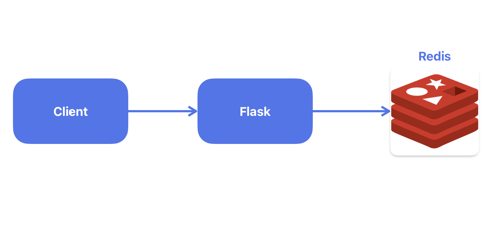

# visit-counter

## CI Pipeline Status


## Opis
Mala web aplikacija koja broji posete i čuva brojač u Redis bazi. Aplikacija je napisana u Flask-u, pakuje se u Docker kontejner i pokreće zajedno sa Redisom preko Docker Compose-a. Svaki push i pull request ka main grani prolazi kroz CI pipeline (GitHub Actions).

## Arhitektura
Klijent šalje HTTP zahteve Flask aplikaciji, a ona u Redis bazi čuva brojač poseta. Oba servisa rade u zasebnim kontejnerima u istoj Docker Compose mreži, Redis nije izložen van nje, a njegovi podaci se čuvaju u volume-u.



## API

Aplikacija sluša na `http://localhost:8080`.

| Metoda | Putanja   | Funkcionalnost                                                 | Menja brojač |
|--------|-----------|----------------------------------------------------------------|--------------|
| GET    | `/visits` | Povećava brojač u Redis-u i vraća novu vrednost                | Da           |
| GET    | `/health` | Proverava da aplikacija radi i da je Redis dostupan            | Ne           |
| GET    | `/`       | Ispisuje poruku i naziv kontejnera u kome se aplikacija nalazi | Ne           |

## Pokretanje aplikacije
Preduslov za pokretanje je instaliran Docker i Git za preuzimanje repozitorijuma
```bash
git clone https://github.com/zeljkooc/visit-counter.git
cd visit-counter
cp .env.example .env
docker compose up -d
```

## Pokretanje testova
```bash
python -m pytest -v
```

## Provera zdravlja aplikacije
Pokrenuti sledeću komandu iz glavnog foldera:
```bash
./scripts/healthcheck.sh http://localhost:8080
```
Skripta poziva `/health` endpoint 5 puta i ispisuje vreme i HTTP kod.

## Važnije odluke
1. Volume za Redis služi da se ne gube podaci ni nakon gašenja aplikacije.
2. Funkcija `incr()` kod endpoint-a /visits je izabrana da bi vrednost u bazi ostala u konzistentnom stanju čak iako stignu 2 zahteva istovremeno.
3. **Osnovne slike `python:3.12-slim` i `redis:7.4-alpine`:** ove verzije zauzimaju manje prostora pa su efikasnije.
4. Redis nije izložen na nekom portu pa nije moguć pristup spolja.

## Pokretanje - Kubernetes
Preduslovi - kreirati kind kubernetes cluster i pokrenuti sledece komande: 
```bash
docker build -t app .
kubectl apply -f k8s/
```
Aplikacija je tada dostupna na `http://localhost:8080`.

Brisanje: `kubectl delete -f k8s/` i `kind delete cluster --name visit-counter`.

## Problemi na koje sam naišao
- Tokom kreiranja **CI Pipeline-a**, postojali su problemi oko biblioteka koje nisu instalirane u skripti.
- Kod endpointa **/visits**, problem je bio što stanje baze nije konzistentno ako se zahtevi šalju brzo ili istovremeno, to je rešeno pomoću `incr()` funkcije.
- Sintaksa kod **healthcheck.sh** skripte - nepoznat format datuma na MacOS.
- Izvlačenje statusa i http koda iz JSON odgovora kod **healthcheck.sh** skripte.

## Šta bih unapredio uz više vremena
- Povećao broj testova
- Dodao sigurnosne provere u pipeline
- Dodao skriptu za sigurnosnu proveru
- Dodao lozinku za Redis
- Naučio ostale oblasti iz bonus zadataka i primenio u njima

## Alati i dokumentacija
- https://www.w3schools.com/bash/
- https://docs.gitlab.com/ci/
- Claude AI - korišćen za ispravljanje grešaka i učenje sintakse za bash i CI.